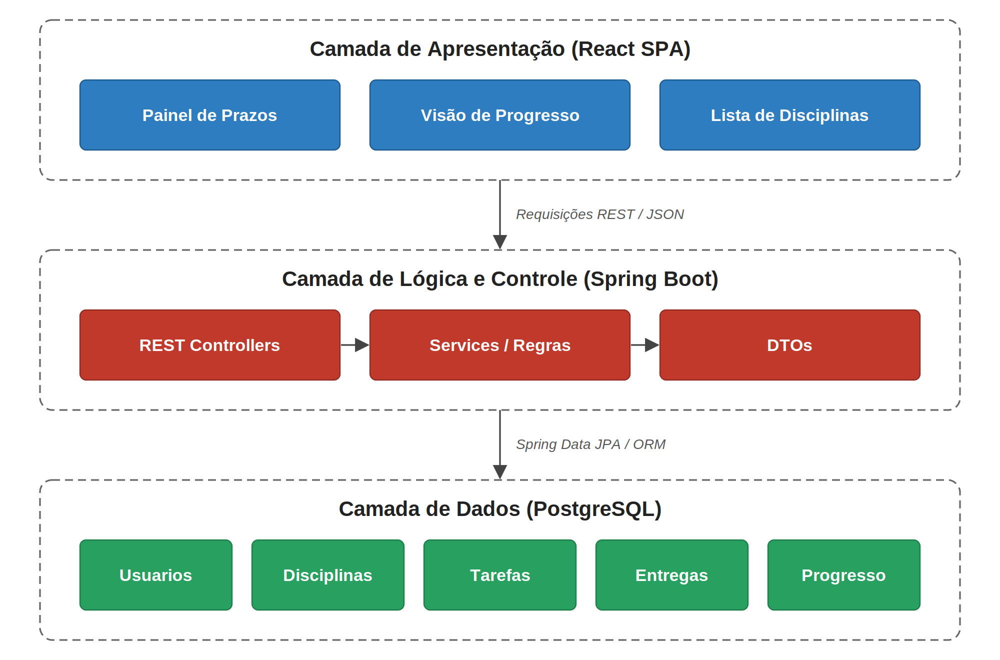
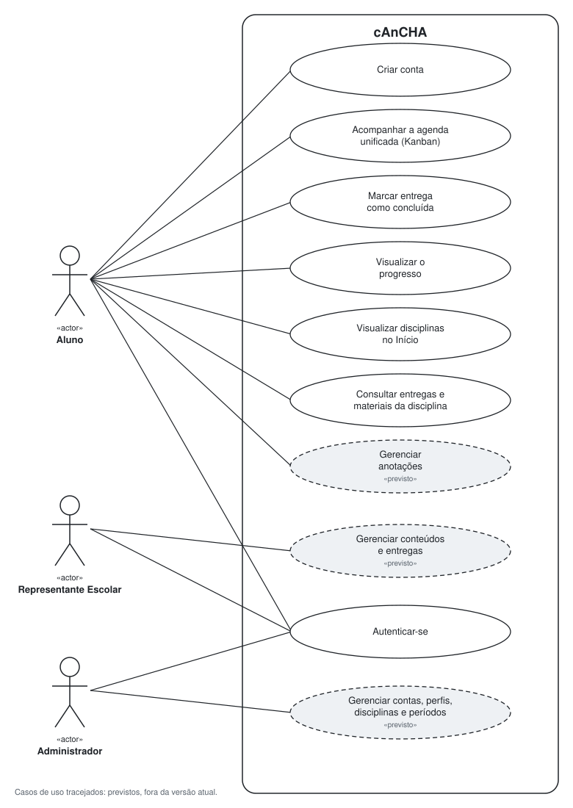
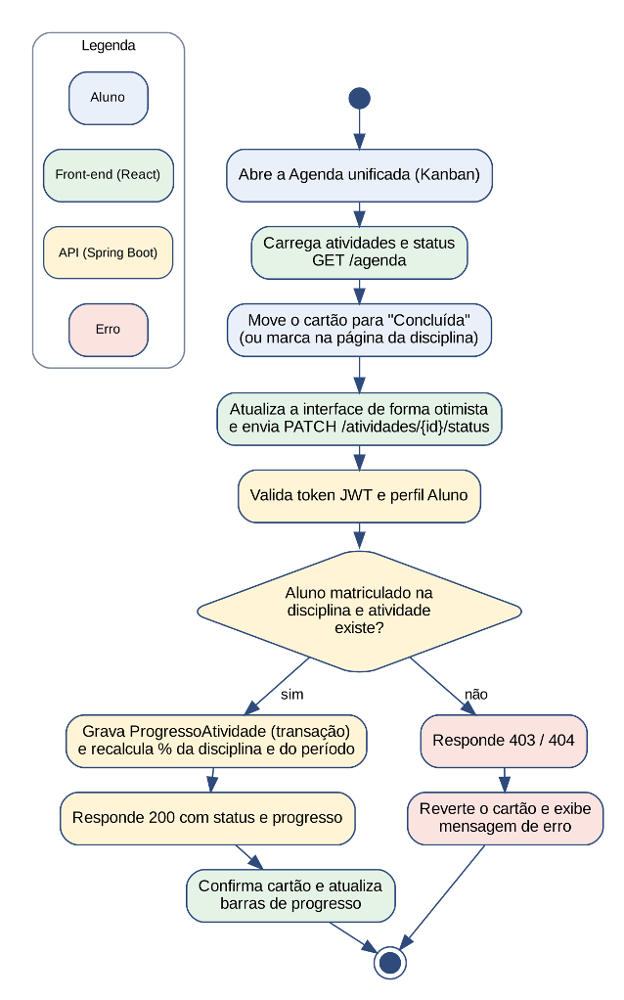
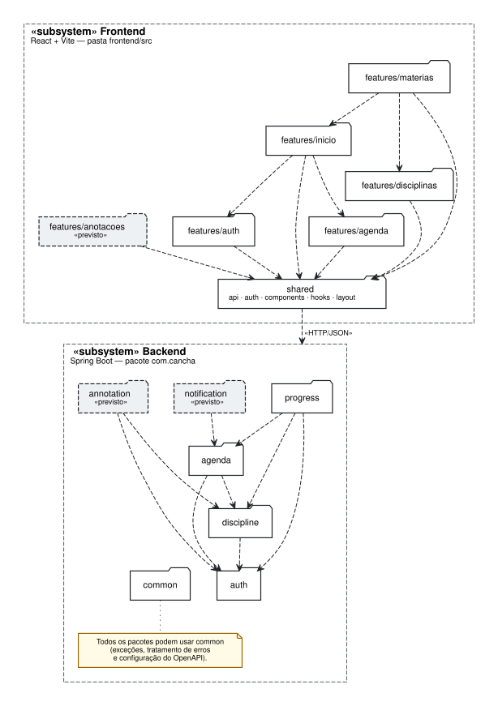
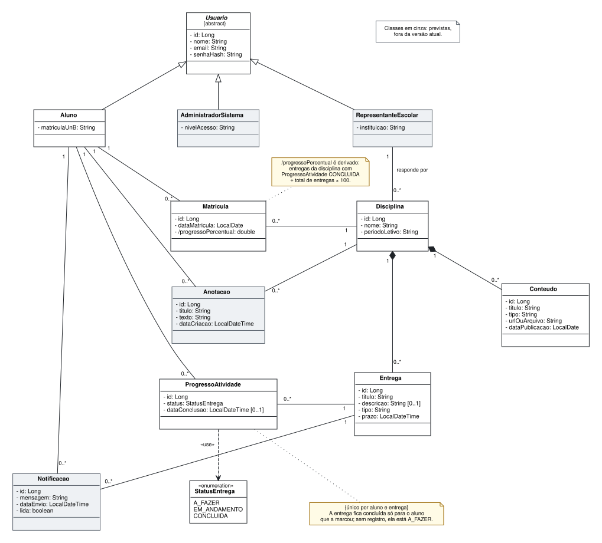
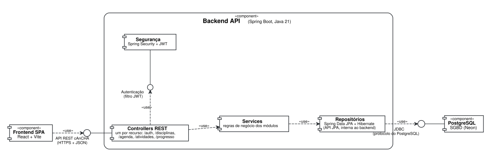
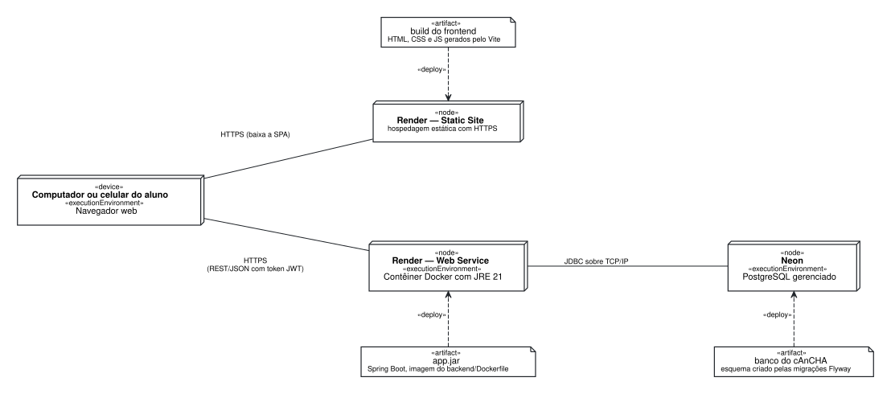

# Documento de Arquitetura do cAnCHA

**Versão 1.4**

## Integrantes do Grupo

A Tabela 1 apresenta os integrantes do grupo, a função de cada um, igual à do Documento de Visão, e os pontos de participação na elaboração deste documento.

**Tabela 1 – Integrantes do grupo e participação na elaboração do documento**

| Matrícula | Nome | Função (responsabilidade) | Pontos de participação na elaboração |
| --- | --- | --- | --- |
| 232014692 | João Lucas R. Cabral | Designer/QA | 16 |
| 242015719 | Thiago Kauã de Sousa Cardoso | Desenvolvedor | 14 |
| 251036440 | Eduardo Viana Ribeiro da Silva | Product Owner | 14 |
| 232024554 | Ana Jullia Barbara Mendes Lopes | Scrum Master/QA | 14 |
| 232014469 | Jefferson de Souza Reis | Desenvolvedor | 14 |
| 241040341 | Pedro Henrique Galdino de Andrade Wollmann | Desenvolvedor | 0 |
| 231036800 | Gustavo Linhares Lima | Desenvolvedor | 14 |
| 242004967 | Pedro Lucas Souza Silva | Desenvolvedor | 14 |
| **Total de pontos** | | | **100** |

*Fonte: elaborado pelo grupo (2026)*

## Histórico de Revisões

| Data | Versão | Descrição | Autor(es) |
| --- | --- | --- | --- |
| 07/10/2026 | 1.0 | Versão inicial do Documento de Arquitetura. | Grupo Torvalds |
| 18/10/2026 | 1.1 | Troca do nome do aplicativo. | João Lucas / Ana Jullia |
| 16/11/2026 | 1.2 | Correções da avaliação do professor: tabela de participação; nome cAnCHA em todo o documento; diagramas de casos de uso, pacotes, classes, componentes e implantação refeitos em notação UML; metas da seção 2.4 com forma de verificação; seção 2.7 sem repetir a 2.4. | Eduardo |
| 18/11/2026 | 1.3 | Correções da inspeção do grupo Perlman: citações no padrão ABNT no texto e referências com data; módulo notification retirado do texto e dos diagramas de pacotes e de classes, por não ter requisito no Documento de Visão. | Eduardo |
| 23/11/2026 | 1.4 | Criação de conta pelo aluno (US13a): caso de uso "Criar conta" na Figura 2, seção 2.5.1, Quadros 2 e 3 e seção 2.7.1. Funções da Tabela 1 iguais às do Documento de Visão, com Ana Jullia como Scrum Master; tabela de integrantes numerada, citada no texto e com fonte (DEF-002, DEF-039, DEF-052). | Eduardo |

# 1 INTRODUÇÃO

## 1.1 Propósito

Este documento descreve a arquitetura de software do cAnCHA, aplicação web de apoio ao estudante de Ensino a Distância (EaD) desenvolvida pelo Grupo Torvalds na disciplina de Métodos de Desenvolvimento de Software (MDS), no semestre 2026.2. Ele registra as decisões estruturais, organizacionais e tecnológicas do sistema e serve de guia para desenvolvedores, testadores, Product Owner e demais interessados.

## 1.2 Escopo

O escopo e os requisitos estão no Documento de Visão. Em linhas gerais, o cAnCHA é uma aplicação web focada na experiência do usuário (UX) que ataca problemas de usabilidade do ambiente EaD: a dificuldade de localizar conteúdos, de acompanhar atividades e prazos e de perceber o próprio progresso.

# 2 REPRESENTAÇÃO ARQUITETURAL

## 2.1 Definições

O sistema adota o estilo Cliente-Servidor em Camadas (BASS; CLEMENTS; KAZMAN, 2021), com uma aplicação de página única (SPA) no cliente e uma API REST no servidor:

* **Apresentação (frontend):** React (META PLATFORMS, [20--]) com Vite, responsável pelas telas e pela interação com o aluno.
* **Aplicação (backend):** Java 21 com Spring Boot (SPRING, [20--]), que expõe os endpoints REST e concentra as regras de negócio e as validações, organizadas em Controllers e Services.
* **Dados:** PostgreSQL (POSTGRESQL GLOBAL DEVELOPMENT GROUP, [20--]), acessado pelos repositórios do Spring Data JPA (Hibernate) por meio do driver JDBC.

## 2.2 Justificativa da escolha

A arquitetura em camadas desacoplada (API REST + SPA) foi escolhida por três motivos:

1. **Foco em UX.** A SPA troca de tela sem recarregar a página e mantém o menu fixo, o que torna a navegação mais rápida. Ela não garante sozinha a regra dos 3 cliques: quem garante é o desenho das rotas e do menu, descrito na seção 2.4 e verificado pelo caso de teste CT-04 e pelas métricas M6 e M7 do Documento de Visão.
2. **Separação de responsabilidades.** Isolar a interface da regra de negócio reduz o acoplamento, limita o impacto das mudanças e permite testar cada camada separadamente (BASS; CLEMENTS; KAZMAN, 2021).
3. **Adequação à equipe.** A divisão entre frontend e backend, e entre módulos dentro de cada um, permite que os oito integrantes trabalhem em paralelo com poucos conflitos no repositório.

## 2.3 Detalhamento

A comunicação entre o frontend e o backend acontece por requisições HTTPS assíncronas, com JSON como contrato de interface. A Figura 1 mostra as camadas.

**Figura 1 – Arquitetura em camadas do cAnCHA**

*Fonte: elaborado pelo grupo (2026)*

Os Controllers do Spring Boot são os conectores da API: expõem os endpoints REST, protegidos por autenticação JWT. As responsabilidades de cada camada são:

* **View (React):** capturar as interações do aluno e exibir os dados recebidos da API.
* **Controller (Spring REST):** mapear as requisições HTTP, validar os dados de entrada e responder com o código de status adequado.
* **Service (Spring):** aplicar as regras do sistema, como o cálculo do progresso e a ordenação das entregas por prazo.
* **Repository (Spring Data JPA):** persistir e consultar os dados no PostgreSQL, pelo driver JDBC.

## 2.4 Metas e restrições arquiteturais

O Quadro 1 apresenta as metas que orientam a arquitetura, como cada uma é atendida e como é verificada.

**Quadro 1 – Metas arquiteturais e forma de verificação**

| Meta | Como a arquitetura atende | Como é verificada |
| --- | --- | --- |
| **Desempenho:** 95% das consultas de disciplinas, agenda e progresso respondidas em até 2 segundos, com o serviço já ativo | Cada tela busca seus dados em uma única chamada (`/disciplinas`, `/agenda`, `/progresso`), e as contagens do progresso são feitas no banco, com consultas agrupadas. | No ambiente publicado (Render e Neon), com o serviço já ativo, são feitas 20 chamadas autenticadas a cada uma dessas rotas e medido o tempo total de resposta. A meta é atingida se ao menos 95% ficarem em até 2 s. O primeiro acesso depois de o serviço dormir não entra na conta (risco R7 do Documento de Visão). O resultado é registrado no relatório de testes da sprint. |
| **Navegação:** qualquer disciplina, entrega ou material em até 3 cliques a partir do Início | Menu fixo com Início, Matérias e Agenda em todas as telas; rotas rasas (`/`, `/materias`, `/disciplinas/{id}` e `/agenda`); entregas e materiais na própria página da disciplina. | O caso de teste CT-04 conta os cliques do Início até uma disciplina, uma entrega e um material. Nos testes de usabilidade, as métricas M6 e M7 contam os cliques feitos por estudantes. |
| **Padrão de API:** uso correto dos verbos e dos códigos HTTP | Um Controller por recurso e erros devolvidos em formato único pelo tratador global de exceções. | Testes de integração dos Controllers e documentação OpenAPI (Swagger) gerada pela própria API. |
| **Padrão de código:** Google Java Style (GOOGLE, [20--]) no backend; ESLint e Prettier no frontend | Configuração do ESLint e do Prettier no repositório. | No frontend, lint e formatação rodam na integração contínua a cada pull request. No backend, o estilo é conferido na revisão de código. |
| **Segurança:** só usuários autenticados acessam os dados, e cada aluno vê só os seus | Autenticação por token JWT validado a cada requisição pelo Spring Security; consultas sempre filtradas pelo aluno autenticado. | Caso de teste CT-01 e testes automatizados de isolamento dos dados entre alunos. |
| **Testabilidade:** cobertura de testes de pelo menos 80% no backend e 70% no frontend | Camadas com responsabilidades isoladas, que permitem testes unitários nos Services e de integração na API, com banco H2 em memória. | No backend, o JaCoCo mede a cobertura de linhas e de ramos a cada execução da integração contínua, que publica o relatório. No frontend, a cobertura será medida pelo Vitest. |

*Fonte: elaborado pelo grupo (2026)*

## 2.5 Visões

As visões a seguir mostram a arquitetura sob quatro pontos de vista (BASS; CLEMENTS; KAZMAN, 2021): uso (escopo do sistema), organização lógica (módulos e suas dependências), estrutura (classes e componentes) e implantação (ambiente de execução).

### 2.5.1 Visão de uso

O Aluno cria a própria conta, consulta disciplinas, entregas, agenda e progresso e registra anotações; o Representante Escolar publica conteúdos e entregas; e o Administrador mantém contas, perfis, disciplinas e períodos. Nesta versão, só o perfil Aluno é implementado; os casos de uso tracejados são previstos. A Figura 2 apresenta o diagrama de casos de uso.

**Figura 2 – Diagrama de casos de uso do cAnCHA**

*Fonte: elaborado pelo grupo (2026)*

A funcionalidade mais complexa do ponto de vista arquitetural é marcar uma entrega como concluída e atualizar o progresso (CEN-04), porque atravessa todas as camadas: a interface, a autorização na API, a regra de negócio, a gravação no banco e o recálculo dos indicadores exibidos ao aluno. A Figura 3 mostra seu diagrama de atividades. A situação gravada é a ProgressoAtividade do aluno para aquela entrega, apresentada no diagrama de classes (Figura 5).

**Figura 3 – Diagrama de atividades – marcar entrega como concluída e atualizar o progresso (CEN-04)**

*Fonte: elaborado pelo grupo (2026)*

O Quadro 2 relaciona os requisitos do Documento de Visão às decisões arquiteturais que eles motivaram.

**Quadro 2 – Requisitos que influenciaram a arquitetura**

| Requisito | Decisão arquitetural motivada |
| --- | --- |
| REQ-02 – Navegação rasa (regra dos 3 cliques) | Rotas rasas, menu fixo e tela Início com as disciplinas (seção 2.4). |
| REQ-04 e REQ-05 – Agenda unificada e painel de progresso | Módulos de agenda e de progresso no servidor, que reúnem os dados de todas as disciplinas em uma única chamada. |
| REQ-07 – Dados sempre vindos da API | API REST com contrato documentado (OpenAPI) e atualização das telas sem recarregar a página. |
| REQ-14 – Criação de conta pelo aluno (US13a) | Endpoint `POST /auth/cadastro` no módulo `auth`, o único da API, além do login, que não exige token; senha guardada só como hash BCrypt; a conta nova é matriculada nas disciplinas de exemplo no próprio cadastro. |
| Perfis de acesso do Documento de Visão (Aluno, Representante Escolar e Administrador) | Autenticação por JWT e autorização por perfil nos filtros do Spring Security. |
| Equipe de oito integrantes, sprints semanais e tecnologias novas para parte do grupo | Estilo em camadas e backend como monólito modular, com módulos que podem ser desenvolvidos em paralelo. |
| Estratégia de testes (seção 6 do Documento de Visão) | Camadas com responsabilidades isoladas, que permitem testes unitários nos Services e de integração na API. |

*Fonte: elaborado pelo grupo (2026)*

### 2.5.2 Visão de organização lógica

O cAnCHA é dividido em módulos funcionais. No backend, cada módulo é um pacote Java dentro de `com.cancha`, com seus próprios Controllers, Services, Repositories e entidades (padrão package-by-feature). No frontend, cada tela principal é uma pasta em `features`, e o que é usado por várias telas fica em `shared`. Essa organização reduz o acoplamento entre funcionalidades e facilita a divisão do trabalho. O Quadro 3 descreve os módulos.

**Quadro 3 – Módulos do cAnCHA e sua razão lógica**

| Pacote (backend) | Pasta (frontend) | Responsabilidade | Situação na versão v0.1.1 |
| --- | --- | --- | --- |
| `com.cancha.auth` | `features/auth`, `shared/auth` | Cria a conta do aluno, autentica o usuário, emite e valida os tokens JWT e informa quem é o aluno autenticado aos demais módulos, que não reimplementam a regra de segurança. | Implementado; a criação de conta (US13a) está em desenvolvimento na Sprint 9 |
| `com.cancha.discipline` | `features/materias`, `features/disciplinas` | Disciplinas do aluno, matrículas e conteúdos (materiais) de cada disciplina; é o módulo central da metáfora do caderno. | Implementado (leitura; a escrita de conteúdos fica com o Representante Escolar, fora desta versão) |
| `com.cancha.agenda` | `features/agenda`, `features/inicio` | Reúne as entregas de todas as disciplinas na agenda Kanban e nas próximas entregas do Início, e registra a situação de cada entrega para cada aluno (ProgressoAtividade). | Implementado |
| `com.cancha.progress` | barras de progresso em `features/inicio`, `features/materias` e `features/disciplinas` | Calcula o percentual concluído por disciplina e no semestre, a partir das entregas (agenda) e das matrículas (discipline). Não tem persistência própria. | Parcial: o cálculo está hoje em `com.cancha.agenda`; o pacote existe sem classes |
| `com.cancha.annotation` | `features/anotacoes` | Anotações do aluno vinculadas a uma disciplina. | Previsto (US06a, Sprint 10, se couber) |
| `com.cancha.common` | — | Tratamento global de erros, exceções comuns e configuração do OpenAPI. | Implementado |
| — | `shared` (`api`, `auth`, `components`, `hooks`, `layout`) | Cliente HTTP único, que anexa o token JWT a cada requisição; sessão do usuário; componentes reutilizáveis, como cartões e barra de progresso; e o layout com o menu fixo. | Implementado |

*Fonte: elaborado pelo grupo (2026)*

A Figura 4 apresenta o diagrama de pacotes. As setas tracejadas são dependências («use»): o pacote de origem usa o pacote de destino.

**Figura 4 – Diagrama de pacotes do cAnCHA**

*Fonte: elaborado pelo grupo (2026)*

No frontend, as pastas de `features` dependem de `shared`, e `shared/api` é o único ponto que chama a API do backend. No backend, as dependências entre módulos passam sempre pela camada de Service do módulo usado, nunca pelos repositórios dele:

* `discipline` depende de `auth`, para saber quem é o aluno autenticado;
* `agenda` depende de `discipline`, porque toda entrega pertence a uma disciplina e só é mostrada a quem está matriculado nela, e de `auth`;
* `progress` depende de `agenda` e de `discipline`, para contar as entregas concluídas de cada matrícula, e de `auth`;
* `annotation` depende de `discipline` e de `auth`;
* todos os módulos podem usar `common`.

Na versão v0.1.1, o cálculo do progresso foi implementado dentro de `agenda` (ProgressoService e PercentualConcluidoService), e `discipline` usa esse cálculo para mostrar o percentual de cada disciplina. Isso cria uma dependência mútua entre `discipline` e `agenda`. Mover o cálculo para `progress`, como prevê esta arquitetura, elimina essa dependência.

O pacote `com.cancha.notification`, criado vazio na estrutura inicial do backend, não corresponde a nenhum requisito do Documento de Visão e por isso não faz parte desta arquitetura. O pacote vazio deve ser removido do código.

**Estratégia de provisionamento de conteúdo.** Disciplina e Conteudo são entidades persistentes desde a primeira versão, com Controller, Service e Repository em `com.cancha.discipline`. Como a pesquisa do grupo investigou só a experiência do Aluno (seção 1.1 do Documento de Visão), os dados entram por carga inicial, em migrações Flyway, sem interface do Representante Escolar. Nesta versão a API só tem os endpoints de leitura. Quando o perfil Representante Escolar entrar no escopo, os endpoints de escrita (POST, PUT e DELETE) serão protegidos por papel no Spring Security, com `@PreAuthorize("hasRole('REPRESENTANTE_ESCOLAR')")`, sem mudança nas camadas de Service e Repository.

### 2.5.3 Visão estrutural

Esta seção detalha os elementos internos do cAnCHA: os dados manipulados (diagrama de classes) e as unidades executáveis com suas interfaces (diagrama de componentes).

O diagrama de classes (Figura 5) representa o modelo de domínio. A classe abstrata Usuario reúne os atributos de identificação e autenticação e é especializada (generalização, seta com triângulo vazado) nos três perfis do Documento de Visão: Aluno, RepresentanteEscolar e AdministradorSistema. Só Aluno está implementado; as classes em cinza são previstas.

Um Aluno se matricula em disciplinas por meio de Matricula. Cada Disciplina é composta (composição, losango cheio) por suas Entregas e seus Conteudos, que deixam de existir se a disciplina for removida. Conteudo é separado de Entrega porque um material de apoio não tem prazo nem situação.

A conclusão de cada entrega é individual. A classe ProgressoAtividade liga um Aluno a uma Entrega e guarda a situação daquela entrega para aquele aluno (StatusEntrega: A_FAZER, EM_ANDAMENTO ou CONCLUIDA) e a data de conclusão. Existe no máximo um registro por aluno e entrega, e uma entrega sem registro está A_FAZER. Por isso a mesma entrega pode estar concluída para um aluno e pendente para outro. O percentual de progresso da Matricula é um atributo derivado (marcado com "/"): é calculado a partir das ProgressoAtividade concluídas, e não informado. Anotacao, ligada a um Aluno e a uma Disciplina, é prevista.

**Figura 5 – Diagrama de classes do domínio do cAnCHA**

*Fonte: elaborado pelo grupo (2026)*

O diagrama de componentes (Figura 6) mostra as unidades executáveis e as interfaces entre elas. A notação é a da UML (OBJECT MANAGEMENT GROUP, 2017): o círculo é uma interface fornecida, ligado por linha cheia ao componente que a implementa, e a seta tracejada «use» parte do componente que precisa dela.

* O Frontend SPA usa a interface API REST cAnCHA (HTTPS + JSON), fornecida pelos Controllers REST do Backend API.
* Dentro do Backend API, os Controllers usam a interface Autenticação, fornecida pelo componente Segurança (Spring Security + JWT), que valida o token e aplica o controle de acesso por perfil antes de a requisição chegar ao Controller.
* Os Controllers usam os Services, e os Services usam os Repositórios.
* Os Repositórios usam a API JPA, implementada pelo Hibernate dentro do próprio backend. O componente PostgreSQL fornece a interface JDBC (protocolo do PostgreSQL), usada pelos Repositórios para executar o SQL gerado pelo Hibernate. JPA, portanto, não é uma interface do banco: é uma API interna do backend.

**Figura 6 – Diagrama de componentes do cAnCHA**

*Fonte: elaborado pelo grupo (2026)*

## 2.6 Visão de implantação

O cAnCHA é publicado em serviços de nuvem e acessado pelo navegador, sem instalação. A implantação separa a entrega estática da interface, a execução da API e o banco de dados, como mostra a Figura 7:

* **Render — Static Site:** hospeda o build do frontend (HTML, CSS e JavaScript gerados pelo Vite), entregue ao navegador por HTTPS.
* **Render — Web Service:** executa o backend em um contêiner Docker com JRE 21, construído a partir do `backend/Dockerfile`, que empacota a aplicação Spring Boot em um `app.jar`.
* **Neon:** serviço gerenciado de PostgreSQL. O esquema do banco é criado e atualizado pelas migrações Flyway, executadas pelo backend ao iniciar.

O navegador do aluno baixa a SPA do Static Site e chama a API no Web Service por HTTPS, com JSON e o token JWT. O backend acessa o PostgreSQL no Neon pelo driver JDBC, sobre TCP/IP. O ambiente é publicado a partir da branch `developer`, e as credenciais ficam só nas variáveis de ambiente do Render.

**Figura 7 – Diagrama de implantação do cAnCHA**

*Fonte: elaborado pelo grupo (2026)*

## 2.7 Restrições adicionais

As metas de desempenho, navegação, segurança e testabilidade estão na seção 2.4. Esta seção registra só as restrições que não aparecem lá.

### 2.7.1 Restrições negociais e de acesso

* Não há uso anônimo: toda funcionalidade exige login, exceto criar a conta.
* O aluno cria a própria conta (US13a), com a matrícula UnB opcional, e a conta nova já recebe as disciplinas de exemplo. As demais disciplinas, as entregas e os conteúdos entram por migração. Não há interface de administração nem de publicação de conteúdos (US11 e US12 estão fora desta versão).
* Os perfis Representante Escolar e Administrador estão no modelo de domínio, mas suas funcionalidades não fazem parte desta versão.

### 2.7.2 Características de qualidade

* **Portabilidade:** o frontend roda nos navegadores atuais, em computador ou celular. O backend roda em contêiner Docker, o que o torna independente do sistema operacional do servidor.
* **Manutenibilidade:** a organização por módulos (package-by-feature) faz com que uma mudança em uma funcionalidade fique restrita, em geral, ao seu pacote e à sua pasta de feature.

### 2.7.3 Restrições técnicas

* Backend em Java 21 com Spring Boot; frontend em React com Vite; banco PostgreSQL com migrações Flyway.
* O plano gratuito do Render suspende o Web Service depois de um período sem acesso, e a primeira requisição seguinte demora a responder. Por isso o serviço é acordado antes de apresentações e testes (risco R7 do Documento de Visão).
* Segredos (credenciais do banco e chave do JWT) nunca ficam no repositório, só nas variáveis de ambiente dos serviços.

# REFERÊNCIAS

BASS, Len; CLEMENTS, Paul; KAZMAN, Rick. **Software architecture in practice**. 4. ed. Boston: Addison-Wesley, 2021.

GOOGLE. **Google Java Style Guide**. [S. l.], [20--]. Disponível em: <https://google.github.io/styleguide/javaguide.html>. Acesso em: 18 nov. 2026.

META PLATFORMS. **React documentation**. [S. l.], [20--]. Disponível em: <https://react.dev>. Acesso em: 7 out. 2026.

OBJECT MANAGEMENT GROUP. **OMG Unified Modeling Language (OMG UML)**: version 2.5.1. [S. l.]: OMG, 2017. Disponível em: <https://www.omg.org/spec/UML/2.5.1>. Acesso em: 16 nov. 2026.

POSTGRESQL GLOBAL DEVELOPMENT GROUP. **PostgreSQL documentation**. [S. l.], [20--]. Disponível em: <https://www.postgresql.org/docs/>. Acesso em: 7 out. 2026.

SPRING. **Spring Boot reference documentation**. [S. l.], [20--]. Disponível em: <https://docs.spring.io/spring-boot/>. Acesso em: 7 out. 2026.
