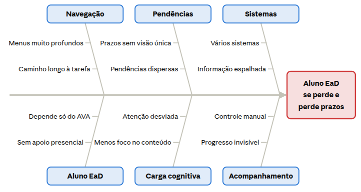
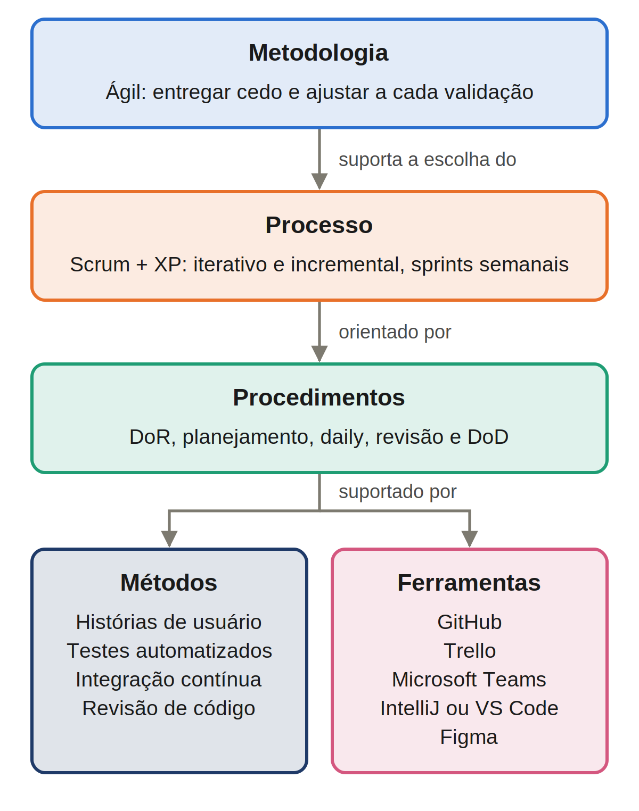

# Documento de Visão

**VISÃO DO PRODUTO E DO PROJETO**

Versão 1.1

## Tabela - Integrantes do Grupo:

| Mat. | Nome | Função (responsabilidade) | Pontos de participação na elaboração |
| ----- | :---- | :---- | :---- |
| 231036800 | Gustavo Linhares Lima | Desenvolvedor | 13.5 |
| 232014469 | Jefferson de Souza Reis | Scrum Master | 12.5 |
| 242004967 | Pedro Lucas Souza Silva | Desenvolvedor | 12.5 |
| 242015719 | Thiago Kauã de Sousa Cardoso | Desenvolvedor | 12.5 |
| 251036440 | Eduardo | Product Owner | 12.5 |
| 232014692 | João Lucas R. Cabral | Designer/QA | 15 |
| 232024554 | Ana Jullia B. M. Lopes | Scrum Master/QA | 12.5 |
| 241040341 | Pedro Henrique Galdino | Desenvolvedor | 9 |
| **Total de pontos** | | **(Devem fechar 100 pontos para toda a equipe.)** | **100** |

## Histórico de Revisões

| Data | Versão | Descrição | Autor |
| :---- | :---- | :---- | :---- |
| 30/09 | 1.0 | Versão inicial do Documento de Visão. | Grupo Torvalds |
| 16/10 | 1.1 | Alteração do nome do produto de "Folha Digital" para "cAnCHA" e reorganização das sprints | Ana Jullia |

# 1 VISÃO GERAL DO PRODUTO

## 1.1 Problema

O problema se insere no contexto acadêmico do Ensino a Distância (EaD), modalidade ofertada por instituições como a UnB e que, em 2024, passou a concentrar 50,7% das matrículas de graduação do país (INEP, 2025). Nesse cenário, a relação do aluno com o curso acontece quase toda dentro do Ambiente Virtual de Aprendizagem (AVA) e de outros sistemas acadêmicos, e é por meio deles que ele localiza conteúdos, acompanha atividades e prazos e percebe o próprio avanço. Esse público é formado por estudantes de perfis variados, incluindo candidatos de programas como o Vestibular 60+ ou usuários com baixo conhecimento de tecnologia.

É justamente nessa organização que está o problema: estudantes em ambientes de EaD podem enfrentar dificuldades para localizar conteúdos, acompanhar atividades, identificar prazos e compreender seu progresso, devido à forma como as informações e interações são organizadas no ambiente. Estudantes da modalidade já apontaram dificuldades de usabilidade no AVA como fator ligado à desistência (AMBIENTES, 2025), o que revela uma oportunidade de desenvolvimento de software voltado à experiência do aluno. Para esclarecer as causas desse problema, o grupo utilizou o diagrama de Ishikawa apresentado na Figura 1.

Figura 1 – Diagrama de Ishikawa do problema de navegação no EaD

Fonte: elaborado pelo grupo (2026)

O efeito analisado, à direita do diagrama, é o aluno de EaD que se perde na navegação e perde prazos. Na parte superior estão as causas ligadas à plataforma. Em Navegação, menus profundos e caminhos longos obrigam o aluno a atravessar vários níveis até a tarefa, e hierarquias mais profundas aumentam o risco de o usuário se perder (ZAPHIRIS; KURNIAWAN; ELLIS, 2003). Em Pendências, a ausência de uma visão única de prazos e atividades impede que o aluno saiba, de relance, o que precisa entregar. Em Sistemas, o uso de vários sistemas acadêmicos espalha essa informação entre plataformas.

Na parte inferior estão as causas ligadas à rotina do aluno e ao esforço gerado. Em Aluno EaD, a dependência quase total do AVA e a ausência de apoio presencial fazem com que qualquer dificuldade na plataforma recaia diretamente sobre o estudante. Em Carga cognitiva, informações espalhadas aumentam a carga cognitiva extrínseca e reduzem a atenção disponível para aprender (COGNITIVE..., 2026). Em Acompanhamento, o controle manual e a falta de visibilidade do progresso deixam o aluno sem uma noção clara de quanto já concluiu, transferindo para ele a tarefa de organizar prazos e avanço por fora.

A leitura do diagrama mostra que a maioria das causas é estrutural: não depende do esforço do aluno, e sim de como a informação é organizada. O problema se concentra, portanto, em dois gargalos: a alta profundidade de navegação (excesso de cliques) e a falta de centralização visual das pendências, dos prazos e do progresso. Por serem causas de organização da informação, a resposta mais direta é um software que reorganize essa informação a partir da perspectiva do aluno.

A solução proposta é um software de visualização de tarefas e acompanhamento de atividades e prazos, com foco em diminuir a quantidade de cliques do usuário. O produto facilita a gestão de tarefas e de tempo, oferecendo uma interface intuitiva que auxilia o aluno a encontrar conteúdo, prazos e progresso usando o modelo mental de um caderno. Cada recurso responde a uma causa identificada no diagrama: o acesso direto às disciplinas reduz a profundidade de navegação; a agenda unificada de entregas centraliza pendências e prazos hoje dispersos entre sistemas; e o painel de progresso, alimentado pelas atividades que o aluno marca como concluídas, mostra quanto ele já avançou em cada disciplina e no período letivo. Com isso, espera-se que o aluno encontre o que precisa com menos passos e menos esforço, acompanhe seus prazos sem controles paralelos e tenha clareza sobre o próprio progresso.

## 1.2 Declaração de Posição do Produto

Quadro 1 – Declaração de posição do produto

| Para: | estudantes de EaD |
| ----: | :---- |
| Necessidade: | Uma plataforma que simplifica a gestão de atividades curriculares, facilitando o acesso às tarefas, a visualização de prazos e a compreensão do progresso dos trabalhos executados (desempenho do discente ao longo do período letivo / estudo). |
| O (nome do produto): | Uma aplicação web chamada cAnCHA. |
| Que: | Organiza a vida acadêmica do aluno como um caderno físico, possui agenda unificada de entregas (estilo kanban) e painel de progresso, possui fácil acesso às disciplinas em no máximo 3 cliques. |
| Ao contrário: | Baixo rendimento escolar para pessoas com dificuldades de navegação em plataformas já existentes; dispersão de responsabilidades entre diferentes softwares (exemplo: Aprender3, SIGAA, Notion), dificultando ainda mais a jornada estudantil. |
| Nosso produto: | Modelo mental de um caderno, facilitando a compreensão do usuário e garantindo uma maior adesão ao software, proporcionando um painel centralizado na experiência do usuário (UX) |

Fonte: elaborado pelo grupo (2026)

## 1.3 Objetivos do Produto

Simplificar a gestão de atividades curriculares, facilitando o acesso do estudante a tarefas, visualização de prazos e entrega de trabalhos.

Objetivos Específicos:

1. Reduzir a quantidade de cliques necessários para localizar tarefas e materiais de aula;
2. Centralizar as pendências e datas limite em um painel visual e dinâmico;
3. Exibir indicadores de progresso por disciplina para auxiliar a gestão de tempo do discente.

Objetivo Secundário:

1. Paralelamente, a aplicação ainda permite que o usuário mantenha anotações e registros dos conteúdos assimilados.

## 1.4 Tecnologias a Serem Utilizadas

**Ferramentas de Desenvolvimento e Design:**

VSCode para codificação, Figma para prototipagem de telas e GitHub para controle de versão e integração contínua.

**Interface/Front-end:**

React.js para construção de interface SPA reativa focada em UX.

**Back-end/API:**

Node.js para gestão de usuários, tarefas e disciplinas.

# 2 VISÃO GERAL DO PROJETO

## 2.1 Ciclo de vida do projeto de desenvolvimento de software

O projeto adota uma metodologia ágil, instanciada em um ciclo de vida híbrido, iterativo e incremental baseado em Scrum e Extreme Programming (XP), com sprints semanais. A Figura 2 mostra como essa escolha se desdobra em processo, procedimentos, métodos e ferramentas, seguindo o modelo apresentado acima.

Figura 2 – Metodologia de desenvolvimento do projeto cAnCHA

Fonte: elaborado pelo grupo (2026)

A metodologia ágil foi escolhida porque o problema é de usabilidade: não basta especificar a interface antes, é preciso verificar com frequência se ela de fato reduz passos e deixa prazos e progressos claros. Uma abordagem ágil permite entregar cedo e ajustar o produto a cada validação, em vez de fixar todos os requisitos no início.

Como processo, adota-se um ciclo de vida híbrido, iterativo e incremental fundamentado em Scrum e XP. Antes da primeira sprint, na fase de iniciação (pré-sprint), a primeira sprint é dedicada à definição do produto: nela a equipe mapeou o problema com o diagrama de Ishikawa, elaborou este Documento de Visão e iniciou o Product Backlog. A partir da segunda sprint, cada ciclo passa a gerar incrementos do software. A partir daí, o Scrum organiza o trabalho em sprints de uma semana, com planejamento no início e revisão e retrospectiva no fim, o que viabiliza o refinamento contínuo do backlog. Cada sprint gera um incremento funcional do software, que acrescenta valor ao produto e é avaliado ao fim da sprint. O XP complementa o Scrum com práticas técnicas que mantêm o código estável entre uma entrega e outra. A sprint semanal permite que cada ajuste de interface chegue rapidamente à validação e se encaixa no ritmo do semestre.

Nos procedimentos, uma história de usuário só entra na sprint quando atende à Definição de Preparado (Definition of Ready): possui critérios de aceitação verificáveis e escopo delimitado pelo Dono do Produto, pequeno o suficiente para ser concluído em uma semana. Cada sprint começa com a seleção das histórias mais prioritárias do backlog e termina com a revisão do incremento produzido, em que o Dono do Produto, representando o aluno, valida as entregas (seção 2.2). Além dessa validação semanal, a equipe realiza testes de usabilidade com estudantes em marcos definidos do projeto, como a conclusão de uma funcionalidade principal, verificando na prática se a interface reduz os passos até a tarefa e deixa prazos e progressos claros. Ao longo da sprint, a equipe realiza reuniões semanais para acompanhar o andamento e identificar impedimentos. Uma história só é considerada concluída, conforme a Definição de Pronto (Definition of Done), quando seus testes passam na integração contínua, critério acompanhado pelo Analista de Qualidade.

Os métodos adotados são as histórias de usuário, que descrevem cada funcionalidade do ponto de vista do aluno (por exemplo, ver em uma única tela todos os prazos da semana); os testes automatizados, que verificam cada funcionalidade entregue; e a integração contínua, que executa esses testes a cada alteração enviada ao repositório. A programação em pares, prática comum do XP, não foi adotada nesta versão do projeto; em seu lugar, a qualidade do código é assegurada pela revisão de código, realizada por meio das inspeções de código atribuídas ao Analista de Qualidade (seção 2.2).

Quanto às ferramentas, o código é versionado no GitHub, que também concentra a integração contínua do projeto. O Product Backlog e o Sprint Backlog são gerenciados no Trello, o que dá transparência ao andamento de cada sprint, e as reuniões semanais acontecem pelo Microsoft Teams. A codificação é feita no IntelliJ IDEA ou no VS Code, a critério de cada integrante, e o design e a prototipação das telas são feitos no Figma.

## 2.2 Organização do Projeto

Quadro 2 – Organização da equipe do projeto

| Papel | Atribuições | Responsável | Participantes |
| :---- | :---- | :---- | :---- |
| Desenvolvedor | Codificar o produto, codificar testes unitários, realizar refatoração | Pedro | Pedro, Thiago, Jefferson, Eduardo, Gustavo, Galdino |
| Designer | Desenvolvimento do Frontend da aplicação, responsável pela experiência de usuários e parte visual do projeto. | João Lucas | João Lucas, Galdino |
| Scrum Master | Gerenciamento de Backlogs do projeto | Ana Jullia | João Lucas, Ana Jullia |
| Dono do Produto | Atualizar o escopo do produto, organizar o escopo das sprints, validar as entregas | Eduardo | Jefferson, Eduardo |
| Analista de Qualidade | Garantir a qualidade do produto, garantir o cumprimento do conceito de pronto, realizar inspeções de código | João Lucas | Pedro, Ana Jullia |
| Cliente | Apresentar as necessidades dos estudantes de EaD e participar dos testes de usabilidade | | |

Fonte: elaborado pelo grupo (2026)

## 2.3 Planejamento das Fases e/ou Iterações do Projeto

O planejamento das fases do projeto foi estruturado em Sprints semanais, alinhadas ao ciclo de vida ágil (Scrum/XP). A Tabela 1 apresenta o cronograma das iterações, especificando o período de execução, os entregáveis esperados, os papéis responsáveis e o percentual de conclusão.

Este planejamento possui caráter evolutivo e será atualizado sucessivamente ao final de cada Sprint, refletindo o real andamento das entregas no repositório da equipe.

Tabela 1 – Planejamento das fases e iterações do projeto

| Sprint | Produto (Entrega) | Data Início | Data Fim | Entregável(eis) | Responsáveis | % conclusão |
| ----- | ----- | ----- | ----- | ----- | ----- | ----- |
| Sprint 1 | Definição do Produto | 16/09/2026 | 30/09/2026 | Documento de Visão, Backlog inicial | Todos | 100% |
| Sprint 2 | Documento de Arquitetura | 01/10/2026 | 07/10/2026 | Documento de Arquitetura | Todos | 100% |
| Sprint 3 | Apresentação | 08/10/2026 | 14/10/2026 | Apresentação do Doc. de Visão, GQM | Todos | 100% |
| Sprint 4 | Apresentação | 15/10/2026 | 21/10/2026 | Apresentação do Doc. de Arquitetura, prova | Todos | 100% |
| Sprint 5 | Prototipação Visual | 22/10/2026 | 28/10/2026 | Protótipo no Figma | DEV, QA, DES | 100% |
| Sprint 6 | Funcionalidades Base e Disciplinas | 29/10/2026 | 04/11/2026 | Fundação técnica, login, telas início/ matérias, backend de disciplinas, Swagger, deploy | DEV, QA, SM | 0% |
| Sprint 7 | Entregas, Materiais e Agenda | 05/11/2026 | 11/11/2026 | Entregas e materiais (back + front), página da disciplina, próximas entregas, testes de aceitação, release | DEV, QA, DES, PO | 0% |
| Sprint 8 | Ajustes pós-Ponto de Controle | 12/11/2026 | 18/11/2026 | Correções de defeitos apontados no Ponto de Controle | DEV, QA | 0% |
| Sprint 9 | Módulo de Anotações | 19/11/2026 | 22/11/2026 | Módulo de anotações integrado ao backend | DEV, QA | 0% |
| Sprint 10 | Testes e Correções | 23/11/2026 | 27/11/2026 | Execução dos testes CT-01 a CT-09 e correção de defeitos finais | DEV, QA, SM | 0% |
| Sprint 11 | Finalização e Entrega | 28/11/2026 | 02/12/2026 | Execução do fluxo completo do aluno, congelamento de código e apresentação do software rodando | Todos | 0% |

Fonte: elaborado pelo grupo (2026)

*(Aliases): PO = Product Owner; SM = Scrum Master; DEV = Desenvolvedores; DES = Designer; QA = Analista de Qualidade.*

## 2.4 Matriz de Comunicação

Quadro 3 – Matriz de comunicação

| Descrição | Área/Envolvidos | Periodicidade | Produtos Gerados |
| :---- | :---- | :---- | :---- |
| Acompanhamento das Atividades em Andamento Acompanhamento dos Riscos, Compromissos, Ações Pendentes, Indicadores | Equipe do Projeto | Semanal | Ata de reunião (Transcrição Teams) Relatório de situação do projeto |
| Comunicar situação do projeto | Equipe Prof/Monitor | Semanal | Ata de reunião, e Relatório de situação do projeto |
| Daily: o que fiz, o que farei, impedimentos | Equipe do Projeto | Semanal | Registro no Trello |

Fonte: elaborado pelo grupo (2026)

## 2.5 Gerenciamento de Riscos

* **Atraso na entrega por sobreposição com avaliações de outras disciplinas:**
  * Grau de exposição: Alto;
  * Plano de mitigação: Planejar Sprints com folga e distribuir tarefas de forma balanceada entre os integrantes;
  * Plano de contingência: Distribuição balanceada entre os membros, priorizando o backlog das tarefas realizadas (MoSCoW).

* **Dificuldade técnica com tecnologias novas para a equipe (ex.: integração Spring Boot + React):**
  * Grau de exposição: Médio;
  * Plano de mitigação: Provas de conceito antecipadas e estudo dirigido nas primeiras sprints;
  * Plano de contingência: Buscar apoio de monitoria/Professor e, se necessário, simplificar o escopo técnico.

* **Esforço subestimado (Ex: Atraso de entrega devido à um escopo maior do que o esperado):**
  * Grau de exposição: Alto;
  * Plano de mitigação: Estimar as histórias de usuário por meio de planning poker e acompanhar a velocidade da equipe a cada sprint, a fim de ajustar o planejamento das sprints seguintes.
  * Plano de contingência: Mover os itens classificados como Should e Could para sprints seguintes, a fim de priorizar a entrega dos requisitos *Must*, e registrar a alteração no planejamento das fases.

* **Requisitos pouco claros ou alterados durante a sprint**
  * Grau de exposição: Alto;
  * Plano de mitigação: Definir critérios de aceitação para cada história de usuário e validar os requisitos com o Product Owner ao final de cada sprint na sprint review.
  * Plano de contingência: Congelar o escopo da sprint em andamento e registrar as alterações no backlog do produto, para serem priorizadas para a sprint seguinte.

## 2.6 Critérios de Replanejamento

O replanejamento do projeto será acionado sempre que desvios de cronograma, problemas técnicos ou eventos imprevistos comprometerem as entregas planejadas para a sprint ou release. Abaixo estão detalhados os critérios e gatilhos de replanejamento mapeados para o projeto:

1) **Replanejamento por Risco de Calendário e Avaliações**

   Gatilho: Redução na disponibilidade da equipe decorrente da sobreposição com avaliações acadêmicas de outras disciplinas.

   Condição de Acionamento: Quando a capacidade estimada de pontos de história da equipe para a Sprint for reduzida em mais de 30% devido ao calendário de provas.

   Ação e Contingência: O time redistribuirá as tarefas entre os membros disponíveis e acionará o Product Owner (PO) para repactuar a Sprint. A priorização utilizará a classificação MoSCoW para congelar ou remover Histórias de Usuário Should e Could, mantendo o foco exclusivo nas histórias essenciais Must Have.

2) **Replanejamento por Incompatibilidade ou Bloqueio Técnico**

   Gatilho: Dificuldades na integração entre tecnologias (Spring Boot + React) ou complexidade imprevista no desenvolvimento.

   Condição de Acionamento: Quando um Spike técnico (investigação arquitetural curta do XP) não solucionar a dúvida tecnológica no prazo estipulado ou uma História de Usuário permanecer bloqueada por mais de 2 dias úteis.

   Ação e Contingência: É solicitado suporte técnico à monitoria ou ao professor. Caso o impedimento persista, os desenvolvedores explicarão as consequências técnicas ao PO para negociar o fatiamento da tarefa, a simplificação do escopo técnico ou a substituição do item por outra demanda do backlog.

3) **Replanejamento por Esforço Subestimado**

   Gatilho: Identificação de que o esforço necessário para concluir uma História de Usuário é significativamente superior ao estimado inicialmente, ocasionando atraso na entrega ou comprometimento das demais atividades da Sprint.

   Condição de Acionamento: Quando uma História de Usuário ultrapassar em 50% ou mais a estimativa de esforço definida no planejamento da Sprint, ou quando o desvio identificado indicar que a conclusão da história comprometerá a entrega dos demais itens planejados para a Sprint.

   Ação e Contingência: O time deverá reavaliar as estimativas das histórias restantes e comunicar o impacto ao Product Owner. Os itens classificados como Should Have e Could Have poderão ser movidos para Sprints seguintes, priorizando a conclusão dos requisitos Must Have. A alteração deverá ser registrada no planejamento das fases e considerada nas estimativas das Sprints seguintes.

4) **Replanejamento por Requisitos Pouco Claros ou Alterados**

   Gatilho: Identificação de ambiguidades nos requisitos, critérios de aceitação insuficientes ou alterações no escopo de uma História de Usuário durante o desenvolvimento da Sprint.

   Condição de Acionamento: Quando uma alteração ou esclarecimento de requisito modificar o escopo, os critérios de aceitação ou o esforço estimado de uma História de Usuário após o início da Sprint, de modo que sua implementação não possa ser concluída conforme o planejamento original.

   Ação e Contingência: O escopo da Sprint em andamento será congelado em relação à História de Usuário afetada, e as alterações identificadas serão registradas no Product Backlog. O Product Owner deverá priorizar as novas demandas para a Sprint seguinte, evitando alterações que comprometam o objetivo da Sprint atual.

# 3 PROCESSO DE DESENVOLVIMENTO DE SOFTWARE

A equipe adota o framework Scrum como processo principal de desenvolvimento, complementado por práticas de Extreme Programming (XP) voltadas à qualidade técnica do código. Os papéis envolvidos seguem a divisão definida na Seção 2.2.

O fluxo de trabalho organiza a engenharia de requisitos nas seguintes macro-atividades:

1. **Elicitação e Descoberta:** Levantamento de necessidades através de questionários e brainstormings.
2. **Análise e Consenso:** Refinamento de histórias e priorização técnica entre o time e o PO antes de cada Sprint Planning.
3. **Declaração:** Formalização de Histórias de Usuário acompanhadas de critérios de aceitação testáveis.
4. **Verificação e Validação:** Testes e validação contínua das entregas com foco nos atributos de qualidade do produto (usabilidade, desempenho e segurança).

# 4 DECLARAÇÃO DE ESCOPO DO PROJETO

## 4.1 Backlog do produto

O Product Backlog do projeto cAnCHA consiste no conjunto de requisitos, funcionalidades e necessidades identificadas para o desenvolvimento do produto. Ele é utilizado como instrumento de organização e priorização do escopo, sendo refinado continuamente ao longo do desenvolvimento do projeto. A organização do backlog considera os perfis de usuários, os cenários funcionais e as histórias de usuário associadas a cada requisito.

A definição e o refinamento dos requisitos são realizados de forma colaborativa entre a equipe de desenvolvimento e o Product Owner (PO). Inicialmente, as necessidades são levantadas por meio de técnicas de elicitação e, posteriormente, analisadas e refinadas para que cada requisito possua escopo delimitado e critérios de aceitação verificáveis. Essa abordagem está alinhada ao processo de desenvolvimento adotado pelo projeto, no qual as histórias de usuário são refinadas e priorizadas antes de cada Sprint Planning.

Para a priorização dos requisitos, a equipe utiliza a classificação MoSCoW, dividindo-os em três categorias utilizadas no projeto: Must Have, Should Have e Could Have. A classificação possui as seguintes definições:

1. Must Have: requisitos considerados essenciais para o funcionamento do produto e para o cumprimento de seus objetivos principais. A ausência desses requisitos compromete a entrega das funcionalidades fundamentais do cAnCHA.
2. Should Have: requisitos importantes para o produto e que agregam valor significativo à experiência do usuário, mas que não impedem o funcionamento das funcionalidades essenciais caso sejam adiados para uma Sprint posterior.
3. Could Have: requisitos desejáveis que complementam a experiência do usuário ou acrescentam funcionalidades ao produto, mas que possuem menor prioridade em relação aos requisitos Must Have e Should Have.

A classificação dos requisitos será utilizada durante o planejamento das Sprints para auxiliar a equipe na definição do escopo de cada ciclo. Em situações de redução de capacidade ou necessidade de replanejamento, os requisitos Should Have e Could Have poderão ser deslocados para Sprints posteriores, preservando a execução dos requisitos Must Have.

### 4.1.1 Elicitação dos requisitos

A elicitação dos requisitos do cAnCHA é realizada principalmente por meio de brainstorming e questionários, técnicas utilizadas para levantar necessidades relacionadas à experiência dos estudantes de EaD e identificar funcionalidades que possam contribuir para a organização das atividades acadêmicas.

O brainstorming é utilizado pela equipe para explorar ideias, identificar problemas e levantar possíveis funcionalidades para o produto de maneira colaborativa. Essa técnica contribui principalmente para a identificação inicial das necessidades e para a geração de alternativas de solução.

Os questionários são utilizados para obter informações diretamente relacionadas às necessidades e dificuldades dos usuários do sistema, permitindo identificar problemas relacionados à localização de conteúdos, acompanhamento de atividades, prazos e progresso acadêmico. Essas informações servem como base para o refinamento dos requisitos e para a validação das funcionalidades propostas.

Após a elicitação, os requisitos são analisados pela equipe e pelo Product Owner, sendo posteriormente formalizados como histórias de usuário acompanhadas de critérios de aceitação testáveis. Dessa forma, o backlog é mantido como um artefato evolutivo, podendo ser atualizado conforme novas necessidades sejam identificadas ou requisitos existentes sejam refinados. O detalhamento dos requisitos, suas respectivas prioridades, tipos e histórias de usuário associadas é apresentado na Seção 4.4.

## 4.2 Perfis

Quadro 4 – Perfis de acesso

| # | Nome do perfil | Características do perfil | Permissões de acesso |
| :---- | :---- | :---- | :---- |
| 1 | Administrador | Responsável por manter os perfis de acesso da aplicação, alterar usuários já existentes, fazer a gestão e manutenção interna do sistema. | Gerenciar contas e perfis de acesso; configurar disciplinas e períodos letivos; acesso de leitura irrestrito para fins de suporte |
| 2 | Aluno | Estudante regularmente matriculado; usuário principal da plataforma, consome conteúdo, acompanha prazos e registra anotações | Visualizar agenda e conteúdos das disciplinas em que está matriculado; registrar/editar suas próprias anotações; visualizar seu painel de progresso |
| 3 | Representante Escolar | Preposto da instituição de ensino responsável por publicar informações acadêmicas | Adicionar, remover e editar conteúdos e atividades |

Fonte: elaborado pelo grupo (2026)

## 4.3 Cenários

Quadro 5 – Cenários funcionais

| Sistema: cAnCHA – Cenários funcionais | | |
| :---: | :---: | :---: |
| Numeração do cenário | Nome do cenário | Sprints |
| CEN-01 | Gestão e Visualização de Disciplinas: O Aluno acessa a plataforma e visualiza todas as matérias matriculadas em formato de fácil acesso (máximo 3 cliques). | Sprint 3 |
| CEN-02 | Navegação e Consulta de Atividades: O aluno abre uma disciplina específica e visualiza rapidamente as tarefas, materiais em anexo e conteúdos. | Sprint 4 |
| CEN-03 | Acompanhamento na Agenda Unificada: O Aluno acessa o painel central para verificar, em uma única visão (Kanban/Calendário), todas as datas limite e entregas pendentes | Sprint 5 |
| CEN-04 | Controle de Progresso: O Aluno marca atividades como concluídas e o sistema atualiza visualmente a barra de progresso da respectiva disciplina e do semestre. | Sprint 5, 6 e 9 |
| CEN-05 | Criação e Gestão de Anotações: O Aluno cria cadernos digitais vinculados às disciplinas para registrar conteúdos assimilados e anotações pessoais. | Sprint 7 |

Fonte: elaborado pelo grupo (2026)

## 4.4 Tabela de Backlog do produto

Quadro 6 – Backlog do produto

| Sistema: cAnCHA – Backlog do produto | | | | | | |
| ----- | :---- | :---- | :---- | :---- | :---- | ----- |
| Numeração (Cenário / requisito) | Sprint | Nome do requisito | Tipo de requisito (Funcional / não funcional) | Priorização do requisito Must, Should, Could | Descrição sucinta do requisito | User histories (U.S.) associadas Identifique as U.S. associadas ao requisito |
| CEN-01 / REQ-01 | Sprint 3 | Dashboard de Disciplinas | Funcional | Must | Sistema deve exibir as disciplinas nas quais o aluno está matriculado logo na página inicial. | US01: Como aluno, quero ver minhas disciplinas na tela inicial para acessá-las rapidamente. |
| CEN-01 / REQ-02 | Sprint 3 | Navegação Rasa (Regra dos 3 Cliques) | Não Funcional | Must | A arquitetura de informação deve permitir que qualquer conteúdo base seja acessado em até 3 cliques. | US02: Como desenvolvedor, devo garantir rotas curtas para atender à regra de acessibilidade. |
| CEN-02 / REQ-03 | Sprint 4 | Listagem de Atividades da Disciplina | Funcional | Must | O sistema deve listar todas as atividades e conteúdos de uma disciplina ao selecioná-la. | US03: Como aluno, quero clicar na disciplina e ver a lista de tarefas da semana para saber o que estudar. |
| CEN-03 / REQ-04 | Sprint 5 | Agenda Unificada (Visão Kanban) | Funcional | Must | O sistema deve agregar todas as pendências de todas as disciplinas em um único quadro de entregas. | US04: Como aluno, quero uma visão Kanban de tarefas a fazer, em andamento e concluídas, para não perder prazos. |
| CEN-04 / REQ-05 | Sprint 5 | Painel de Progresso Acadêmico | Funcional | Should | O sistema deve exibir indicadores visuais (gráficos/barras) do percentual de conclusão do aluno. | US05: Como aluno, quero ver uma barra de progresso por disciplina para gerenciar melhor meu tempo de estudo. |
| CEN-05 / REQ-06 | Sprint7 | Módulo de Anotações Livres | Funcional | Could | O sistema deve permitir criar notas em texto rico associadas a uma disciplina específica. | US06: Como aluno, quero poder escrever anotações no sistema, para centralizar meus estudos na mesma plataforma. |
| CEN-03 / REQ-07 | Sprint 8 | Integração Front-end /API (Sincronização) | Não Funcional | Must | O Front-end em React.js deve espel
