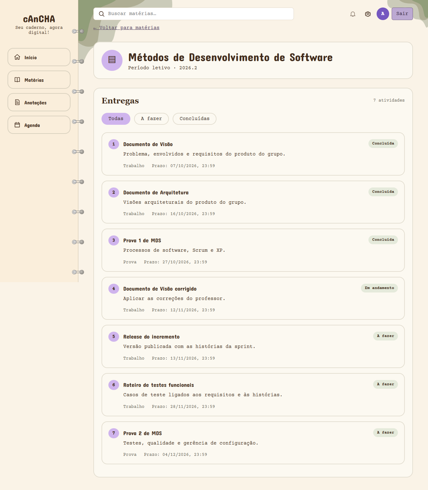

# Relatório de execução dos testes — Sprint 7

| | |
|---|---|
| **Responsável** | João Lucas R. Cabral (Analista de Qualidade) |
| **Data da execução** | 10 e 11/11/2026 |
| **Versão da aplicação** | `developer` em `2390f7a` (após os merges dos PRs #64, #65 e #71) |
| **Casos executados** | CT-01, CT-02, CT-03, CT-04, CT-05, CT-07, CT-08 |
| **Roteiro de referência** | [Documento de Visão v1.2](../documento-de-visao.md), seção 6.2 |
| **Atualização** | 11/11/2026: os defeitos D1 e D2 foram corrigidos e entraram na release v0.1.0 (ver [seção 8](#8-situacao-dos-defeitos)) |

## 1. Resumo

A execução foi feita em dois níveis: **API** (com `curl`, direto nos endpoints) e **interface** (navegador dirigido por script, simulando o aluno).

| Nível | Verificações | Passaram | Falharam |
|---|---|---|---|
| API | 45 | 43 | 2 |
| Interface | 17 | 11 | 6 |

As 6 falhas de interface se reduzem a **2 defeitos** (cada um reprova várias verificações). As 2 falhas de API são de uma funcionalidade ainda não mergeada, não de defeito.

**Conclusão:** o back-end cumpre o que a Visão pede. Os dois defeitos estão no front-end e são de **integração** — cada peça funciona isolada, e a junção é que falha.

## 2. Defeitos encontrados

### D1 — Agenda fica em branco ([issue #95](https://github.com/FGA0138-MDS-Ajax/2026.2-T03-Torvalds/issues/95))

**Situação:** corrigido no [PR #101](https://github.com/FGA0138-MDS-Ajax/2026.2-T03-Torvalds/pull/101), na release v0.1.0.

A tela `/agenda` não renderiza nada. O `GET /agenda` responde 200, mas o front quebra ao consumir.

O back-end devolve um objeto agrupado (`{"A_FAZER": [...], "EM_ANDAMENTO": [...], "CONCLUIDA": [...]}`) e `AgendaPage.jsx` trata a resposta como array, chamando `itens.filter(...)`. O resultado é `TypeError: itens.filter is not a function` durante a renderização.

**Impacto:** a US04a (Agenda Kanban, Must) não é demonstrável. Afeta o CT-05.

### D2 — Materiais não aparecem na disciplina ([issue #96](https://github.com/FGA0138-MDS-Ajax/2026.2-T03-Torvalds/issues/96))

**Situação:** corrigido no [PR #102](https://github.com/FGA0138-MDS-Ajax/2026.2-T03-Torvalds/pull/102), na release v0.1.0.

A página da disciplina mostra apenas as entregas. O `disciplinaApi.js` nunca chama `GET /disciplinas/{id}/conteudos`, então a seção de materiais não existe na tela.

O back-end responde corretamente: em MDS devolve "Scrum Guide" e "Princípios ágeis", com tipo, data e link.

**Impacto:** a US03b (Materiais da disciplina, Must) não é demonstrável. Como não há nenhum link com `target="_blank"`, o critério "abre em nova aba" também fica sem como verificar. Afeta os CT-03 e CT-04.

## 3. Resultado por caso de teste

| Caso | Resultado | Observação |
|---|---|---|
| CT-01 Autenticação | **Passou** | Senha errada mostra a mensagem; tela protegida sem login redireciona ao login; token inválido devolve 401. |
| CT-02 Acesso às disciplinas | **Passou** | As 5 disciplinas da carga aparecem e cada card abre a disciplina. |
| CT-03 Entrega e material | **Falhou** | Entregas corretas e ordenadas por prazo. Materiais não aparecem (D2). |
| CT-04 Limite de navegação | **Passou com ressalva** | Disciplina em 1 clique, entrega em 1, Agenda em 1 — todos dentro do limite de 3. O alvo "material" não pôde ser contado por causa do D2. |
| CT-05 Agenda e próximas entregas | **Falhou** | As próximas entregas no Início estão certas (5 itens, sem concluídas, ordenadas). A Agenda não renderiza (D1). |
| CT-07 Painel de progresso | **Passou** | Progresso por disciplina e no semestre coerentes com as entregas concluídas; o valor muda ao concluir uma entrega, sem recarregar a página. |
| CT-08 Integração front-end e API | **Passou** | Todas as telas obtêm os dados da API; as alterações se refletem sem recarregar. |

CT-06 (anotações) e CT-09/CT-10 completos não foram executados: a funcionalidade de anotações está prevista para a Sprint 10 e o fluxo completo depende dos dois defeitos acima.

## 4. Verificações adicionais

**Isolamento entre alunos.** Um aluno nunca vê nem altera dados de outro. O aluno sem matrícula (`aluno3@cancha.test`, da carga V7) recebe `403` ao tentar ler atividades, materiais ou concluir entregas de disciplinas em que não está matriculado, e vê listas vazias bem formadas nas telas gerais.

**Legibilidade (US02).** Nenhum texto visível abaixo de 14px, medido sobre os elementos renderizados.

**Cobertura do back-end (JaCoCo).** 90,1% de linhas e 83,3% de ramos, com 109 testes passando — acima da meta de 80% da estratégia de testes.

**Desempenho (REQ-13).** Com o serviço já ativo, `/disciplinas`, `/agenda` e `/progresso` responderam entre 1,2 e 1,8 s no Render, dentro da meta de 2 s. O primeiro acesso após o serviço dormir levou **175 s**, o que confirma o risco R7: é preciso acordar o ambiente antes da apresentação.

## 5. Nota sobre o roteiro de testes

Os valores esperados dos casos de teste na Visão v1.2 **não batem** com a carga de exemplo atual (V7), porque os prazos do seed são relativos a `CURRENT_DATE` e o número de entregas mudou.

| Caso | A Visão espera | Os dados atuais têm |
|---|---|---|
| CT-03 | Entregas "Lista 1, Trabalho 1, Prova 1, Lista 2"; prazo 14/11 | 7 entregas em MDS, com outros títulos e prazos relativos |
| CT-05 | 10 entregas, 1 concluída | 25 entregas: 10 a fazer, 4 em andamento, 11 concluídas |
| CT-07 | MDS 25% → 50%; semestre 2 de 10 | MDS 42,9%; semestre 11 de 25 |
| CT-03 | Material "Slides da aula 1" | "Scrum Guide" e "Princípios ágeis" |

Por isso a execução verificou os **critérios** de cada caso (ordenação, coerência do cálculo, permissões, estados vazios) em vez dos números fixos: um valor fixo escrito hoje volta a ficar desatualizado assim que a carga mudar ou o dia virar.

**Recomendação:** na revisão do roteiro, trocar os valores fixos por critérios verificáveis — por exemplo, "o progresso da disciplina é igual a concluídas ÷ total" em vez de "a barra mostra 25%". Também vale alinhar o nome: a Visão fala em "materiais" e a API expõe `/conteudos`.

## 6. Observação sobre a suíte automatizada

O defeito D1 passou pela CI porque `AgendaPage.test.jsx` monta o mock da agenda como um **array**, ou seja, valida um contrato diferente do que a API entrega. Os testes do front ficam verdes e a tela quebra assim mesmo.

Ao corrigir o D1, vale ajustar o mock para o formato real da resposta — senão o teste continua verde sobre uma tela quebrada. É o mesmo cuidado que vale para os demais testes de tela: quando o mock e a API divergem, o teste deixa de proteger.

## 7. Como reproduzir

1. Subir o ambiente: `docker compose up --build -d` na raiz do repositório.
2. Em `frontend/`, criar `.env.local` com `VITE_API_URL=http://localhost:8080` e rodar `npm run dev`.
3. Entrar com `aluno1@cancha.test` e a senha de desenvolvimento descrita no [README do back-end](https://github.com/FGA0138-MDS-Ajax/2026.2-T03-Torvalds/blob/developer/backend/README.md).

Os alunos de teste da carga V7 são `aluno1` e `aluno2` (matriculados nas 5 disciplinas) e `aluno3` (sem matrícula, para verificar os estados vazios e as permissões).

## 8. Situação dos defeitos

Atualizado em 11/11/2026, depois da release v0.1.0.

| Defeito | Correção | Casos a reexecutar |
|---|---|---|
| D1 — Agenda em branco ([#95](https://github.com/FGA0138-MDS-Ajax/2026.2-T03-Torvalds/issues/95)) | [PR #101](https://github.com/FGA0138-MDS-Ajax/2026.2-T03-Torvalds/pull/101): a tela transforma a resposta agrupada do `GET /agenda` em uma lista. O teste da página passou a usar o formato real da resposta, como recomendado na seção 6. | CT-05 |
| D2 — Materiais não aparecem ([#96](https://github.com/FGA0138-MDS-Ajax/2026.2-T03-Torvalds/issues/96)) | [PR #102](https://github.com/FGA0138-MDS-Ajax/2026.2-T03-Torvalds/pull/102): a página da disciplina chama `GET /disciplinas/{id}/conteudos` e mostra a seção Materiais, com o link abrindo em nova aba. | CT-03 e CT-04 (cliques até um material) |

Os resultados da seção 3 continuam valendo para a versão testada (`2390f7a`). A reexecução de CT-03, CT-04 e CT-05 na release v0.1.0 fica com o Analista de Qualidade e deve ser registrada neste relatório ou no da Sprint 8.
